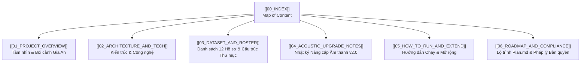

# 🎙️ Gia An AIoT — Elderly Voice Cloning Knowledge Vault

Chào mừng đến với **Obsidian Knowledge Vault** của dự án **Elderly Voice Cloning (Gia An AIoT)**. Tài liệu trong vault này được cấu trúc theo dạng bản đồ tri thức (Map of Content - MOC), liên kết chéo hai chiều (bi-directional links `[[...]]`) giúp lập trình viên và nhà nghiên cứu nắm bắt toàn bộ kiến trúc, công nghệ và dữ liệu dự án mà **không cần phải đọc từng file mã nguồn**.

---

## 🗺️ Bản Đồ Tri Thức (Table of Contents)

---

## 📑 Danh mục Tài liệu Chi tiết

1. **[[01_PROJECT_OVERVIEW]] — Tổng Quan & Sứ Mệnh Dự Án**
   - Bài toán AI Voice & Routine trong hệ thống trợ lý chăm sóc người cao tuổi Gia An.
   - Thách thức về dữ liệu khan hiếm và rào cản bản quyền/pháp lý khi thu thập giọng nói.
   - Chiến lược tiếp cận: Tổng hợp có kiểm soát (Controlled Synthetic Voice) kết hợp dữ liệu tình nguyện viên.

2. **[[02_ARCHITECTURE_AND_TECH]] — Kiến Trúc Kỹ Thuật & Công Nghệ Cốt Lõi**
   - Mô hình nền tảng: **ZeroTTS** (MOSS Codec, ONNX Runtime nội bộ, hoàn toàn offline).
   - Công nghệ **Latent Space Vector Blending** (Nội suy embedding đặc trưng người nói).
   - Bộ xử lý **Organic Analog Warmth & Presbyphonia EQ** (loại bỏ hoàn toàn âm thanh méo máy / robot).
   - Hệ thống giả lập tạp âm thực tế (TV, nhà bếp, quạt gió, tiếng ngoài đường, vang phòng).

3. **[[03_DATASET_AND_ROSTER]] — Ma Trận Phủ 12 Hồ Sơ Người Cao Tuổi & Cấu Trúc Thư Mục**
   - Danh sách 12 cụ ông / cụ bà trải đều 3 miền (Bắc – Trung – Nam) từ 50 đến 84 tuổi.
   - Quy chuẩn đặt tên thư mục và tên file chuẩn hóa quốc tế.
   - Bộ câu mẫu kiểm chuẩn: *"Xin chào Gia An, Gia An có nghe rõ tôi nói không?"*.
   - Manifest chuẩn hóa: `manifest.jsonl` và `metadata.csv` (UTF-8 BOM).

4. **[[04_ACOUSTIC_UPGRADE_NOTES]] — Nhật Ký Nâng Cấp Chất Lượng Âm Thanh (Version 2.0)**
   - Phân tích nguyên nhân phiên bản v1 bị "giọng máy / robot": Lỗi Phase-vocoder, Ring modulator sin, Brickwall filter.
   - Giải pháp công nghệ v2: Giữ nguyên độ phân giải studio 48,000 Hz, nội suy vector latent, biquad chest resonance, soft saturation.
   - So sánh định lượng các chỉ số âm học ($F_0$, Jitter, Shimmer, HNR).

5. **[[05_HOW_TO_RUN_AND_EXTEND]] — Sổ Tay Lập Trình Viên & Hướng Dẫn Thực Thi**
   - Cài đặt môi trường, chạy CLI sinh dữ liệu hàng loạt.
   - Công cụ kiểm tra tính toàn vẹn `verify_dataset.py` và đo âm học `analyze_audio.py`.
   - Chạy test suite `run_tests.sh`.
   - Hướng dẫn thêm hồ sơ người già mới hoặc nạp dữ liệu thu âm tình nguyện viên.

6. **[[06_ROADMAP_AND_COMPLIANCE]] — Bám Sát Lộ Trình Plan.md & Phối Hợp Kỹ Thuật**
   - 6 giai đoạn phát triển theo [[plan.md]].
   - Ranh giới kỹ thuật: Close-talk sạch vs Far-field / Room impulse response của dev khác.
   - Bộ tiêu chuẩn văn bản Consent và bảo vệ dữ liệu sinh trắc học người già.

---

> [!TIP]
> **Cách sử dụng với Obsidian**: Mở phần mềm Obsidian, chọn **"Open folder as vault"** và duyệt đến thư mục `elderly-voice-cloning/vault/`. Bạn sẽ thấy biểu đồ Graph View kết nối liên kết chặt chẽ toàn bộ dự án.
