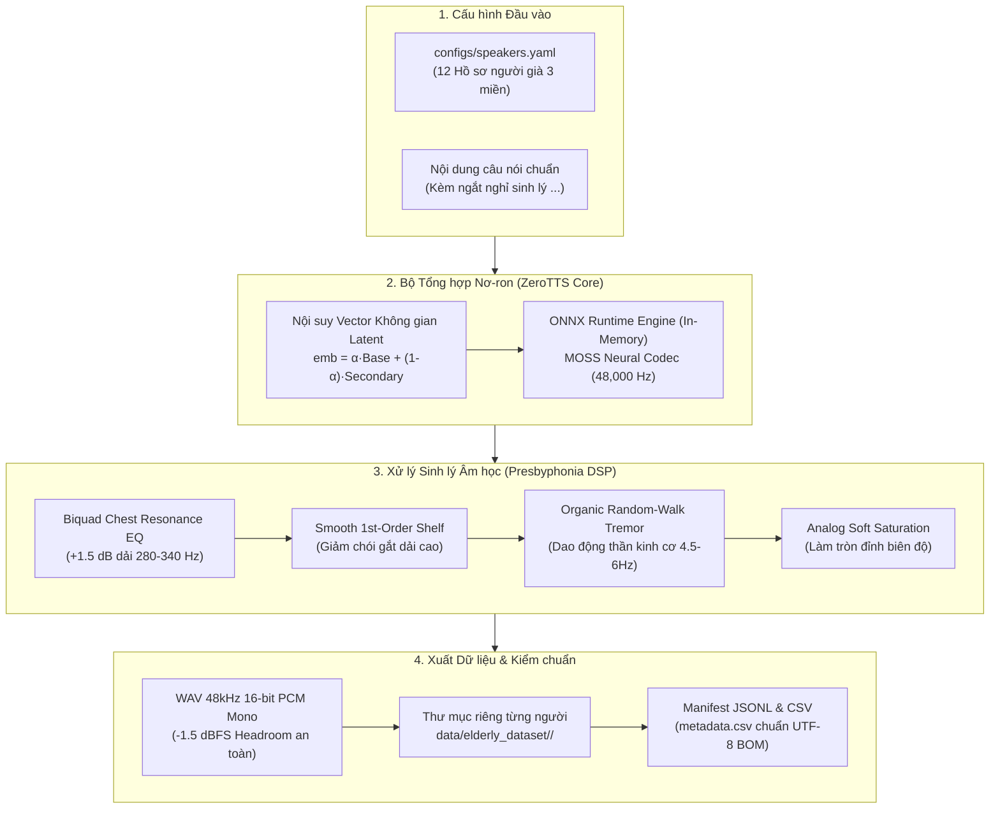

# 02. Kiến Trúc Kỹ Thuật & Công Nghệ Cốt Lõi

*Liên kết:* [[00_INDEX]] | [[01_PROJECT_OVERVIEW]] | [[04_ACOUSTIC_UPGRADE_NOTES]] | [[05_HOW_TO_RUN_AND_EXTEND]]

---

## 1. Sơ Đồ Kiến Trúc Hệ Thống (Pipeline Architecture)

---

## 2. Các Công Nghệ Cốt Lõi Chi Tiết

### 2.1. ZeroTTS & MOSS Neural Codec
- **Bản quyền & Vận hành**: Mô hình nguồn mở với giấy phép Apache-2.0, chạy hoàn toàn offline 100% bằng **ONNX Runtime** (không gọi bất kỳ API bên thứ ba nào, không lo ngại bị chặn request hay rò rỉ dữ liệu).
- **Tần số lấy mẫu Native**: **48,000 Hz** (chuẩn phòng thu âm chuyên nghiệp). Khác biệt hoàn toàn với các mô hình TTS cũ bị giới hạn ở 16 kHz hay 24 kHz vốn làm âm thanh bị bí và mất chi tiết dải cao.
- **Tốc độ thời gian thực (Real-time Factor)**: $\text{RTF} \approx 0.6$ (sinh 3.5 giây audio chỉ mất khoảng 1.8 – 2.0 giây trên CPU tiêu chuẩn).

### 2.2. Công nghệ Nội suy Không gian Latent (Latent Space Continuous Blending)
- Mỗi giọng nói trong ZeroTTS là một mảng vector đặc trưng người nói (speaker latents) có kích thước:
  $$\mathbf{z} \in \mathbb{R}^{1 \times 10 \times 768}$$
- Thay vì chỉ sử dụng các giọng cứng nhắc cố định, hệ thống triển khai thuật toán nội suy liên tục trên đa tạp biểu diễn (speaker representation manifold):
  $$\mathbf{z}_{\text{profile}} = \alpha \mathbf{z}_{\text{anchor1}} + (1 - \alpha) \mathbf{z}_{\text{anchor2}}$$
  $$\mathbf{z}_{\text{final}} = \mathbf{z}_{\text{profile}} \cdot \frac{\|\mathbf{z}_{\text{anchor1}}\|_2}{\|\mathbf{z}_{\text{profile}}\|_2}$$
- **Lợi ích vượt trội**: Mỗi người già có một "vân giọng" (voice timbre) hoàn toàn độc nhất vô nhị về độ sâu âm vực, độ dày thanh quản, nhưng vẫn bảo tồn được tính chất ngữ điệu tự nhiên do mạng nơ-ron sinh ra từ gốc.

### 2.3. Bộ Xử lý Sinh lý Lão hóa Tự nhiên (Organic Presbyphonia DSP)
Nhằm khắc phục triệt để nhược điểm "tiếng máy / robot" của phiên bản cũ, toàn bộ các phép biến đổi thô thiển (như Phase Vocoder pitch-shift, STFT time-stretch và sóng sin nhân điều chế biên độ) đã bị loại bỏ. Thay vào đó là các nguyên lý âm học vật lý:
1. **Chest Resonance Peaking Filter**: Tăng cường cộng hưởng lồng ngực (+1.2 dB đến +1.8 dB quanh dải 280–340 Hz với hệ số chất lượng $Q = 1.2$). Giúp giọng các cụ ông và cụ bà có chiều sâu, ấm và đầm hơn.
2. **Organic High-Shelf Softening**: Sử dụng bộ lọc bướm bậc 1 (1st-order shelf) mượt mà làm dịu dải tần số cao trên 6 kHz, mô phỏng sự suy giảm tự nhiên của các họa âm cao theo tuổi tác mà không gây cảm giác "bí tiếng" như bộ lọc thông thấp bậc cao (brickwall).
3. **Biological Random-Walk Micro-Tremor**: Đối với người từ 75 tuổi trở lên, độ run thanh quản được điều chế bằng tín hiệu ồn hồng (1/f filtered random walk) trong dải thần kinh cơ 4.5–6.0 Hz với biên độ tinh tế ($< 3.5\%$). Âm thanh nghe giống như cơ bắp người thật đang rung động, không hề giống hiệu ứng tremolo nhân tạo của máy tính.
4. **Analog Warmth Saturation**: Mô phỏng đặc tính truyền dẫn phi tuyến của đèn chân không / băng từ analog bằng hàm $\tanh(x)$, giúp làm tròn các đỉnh biên độ đột ngột (transient smoothing) và tạo độ ấm tự nhiên cho giọng nói.

### 2.4. Trộn Nhiễu Môi Trường Đa Kịch Bản (Acoustic Augmentation Engine)
Dành cho thư mục kịch bản `giong_co_nhieu`, hệ thống hỗ trợ trộn các nguồn tạp âm thực tế với mức tỉ số tín hiệu trên nhiễu (SNR) có kiểm soát:
- **Tiếng TV phòng khách (`tv_background`)**: Mô phỏng bản tin thời sự hoặc hội thoại TV phát ở khoảng cách 3–4m.
- **Tiếng ồn nhà bếp (`kitchen_noise`)**: Tiếng chén bát va chạm, tiếng xào nấu, nước chảy và máy hút mùi.
- **Tiếng quạt gió / điều hòa (`fan_noise`)**: Tạp âm ù trầm liên tục 50–150 Hz và luồng gió thổi.
- **Tiếng đường phố (`street_ambient`)**: Rung chấn xe cộ bên ngoài hắt qua cửa sổ.
- **Vang phòng khoảng cách xa (`room_reverb_farfield`)**: Mô phỏng hiện tượng người già bị ngã xa mic nhờ bộ phản xạ âm Schroeder Reverberator.
