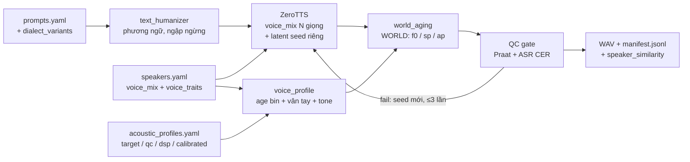

# 07. Version 3.0 — Humanize Giọng Người Cao Tuổi (WORLD Aging Engine)

*Liên kết:* [[00_INDEX]] | [[02_ARCHITECTURE_AND_TECH]] | [[04_ACOUSTIC_UPGRADE_NOTES]] | [[05_HOW_TO_RUN_AND_EXTEND]]

---

## 1. Vì sao cần v3.0

Đo lại dataset v2.0 bằng Praat (chuẩn đo lâm sàng) cho thấy 4 vấn đề gốc:

| Vấn đề v2.0 | Bằng chứng đo được |
|---|---|
| **12 cụ nghe như 2 người** | 6/6 cụ ông dùng `huuduc` làm giọng gốc; 5/6 cụ bà dùng `kimoanh`. Cosine WavLM-SV giữa các cặp cùng giới: **0.95–0.99** |
| **Không có đặc trưng tuổi** | Tốc độ nói của mọi cụ (50→84 tuổi) đều 3.7–4.9 âm tiết/s; jitter nữ đều ~1.3–1.6% |
| **Tham số lão hoá không được dùng** | `acoustic_profiles.yaml` khai báo jitter/shimmer/tempo… nhưng DSP v2 chỉ nhận `age` → EQ + low-pass + tanh |
| **Bộ đo sai** | Manifest v2: jitter nam luôn = 15% (giá trị trần), HNR = 0 dB → không thể đánh giá tiến bộ |

---

## 2. Kiến trúc pipeline v3.0

### 2.1. Engine lão hoá WORLD (`src/synthesis/world_aging.py`)
Giọng ZeroTTS được tách bằng vocoder **WORLD** thành F0 (harvest), phổ (cheaptrick) và aperiodicity (d4c). Mỗi dấu hiệu lão hoá tác động đúng thành phần sinh lý của nó, rồi tổng hợp lại **một lần** (không có phase-vocoder → không rè kim loại):

| Dấu hiệu | Thành phần | Cách làm |
|---|---|---|
| Cao độ (F0) theo tuổi/giới | f0 | Dịch log-F0 tới **đích tuyệt đối** (nam: giảm 50–70t rồi tăng lại 80+; nữ: giảm dần). Co giãn biên độ ≥ 0.85 để **giữ 6 thanh điệu** |
| Jitter | f0 | Nhiễu **theo từng chu kỳ thanh môn** trên lưới 2 ms (nhiễu theo frame bị WORLD làm mượt mất) |
| Run giọng (tremor) | f0 + sp | LFO 4–7 Hz, tần số và độ sâu **trôi ngẫu nhiên** (không phải sin máy) |
| Shimmer | sp | Nhiễu biên độ theo từng chu kỳ |
| Hụt hơi / khàn | ap | Nâng aperiodicity, trọng số tăng theo tần số, biến thiên chậm theo thời gian |
| Thanh quản yếu | sp | Warp formant (≤ 0.96–1.02) + tăng spectral tilt |
| Vocal fry | f0/ap/sp | Cuối cụm từ: hạ F0, F0 bất ổn, năng lượng giảm |
| Đứt tiếng | f0/ap/sp | Xác suất nhỏ (Poisson theo giây hữu thanh) |
| Nhịp nói & ngắt nghỉ | khung thời gian | Time-map không đều (`prosody.py`): lời nói chậm theo `tempo`, **khoảng lặng kéo dài hơn** theo `pause_scale` |
| Hít hơi trước câu | waveform | Nhiễu dải 500–2600 Hz, đường bao bất đối xứng |

### 2.2. Mỗi cụ một danh tính (`voice_profile.py`, `speakers.yaml`)
- **`voice_mix`**: pha 1–3 voice pack khác nhau (vd. `{tiendat: 0.65, huuduc: 0.35}`) + nhiễu latent có seed theo `speaker.id`.
- **`voice_traits`** (dấu vân tay): `f0_offset_st`, `formant_warp`, `hoarseness`, `tremor_severity`, `tremor_rate_hz`, `speech_rate_factor`, `pitch_range_scale`, `spectral_tilt_db_oct`. Trait nào không khai báo sẽ được lấy mẫu **tất định** trong dải của nhóm tuổi (seed = hash `speaker.id`) → sinh lại luôn ra đúng giọng đó.
- **Tone** của câu (`panicked`, `in_pain`, `breathless`…) cộng thêm F0, đổi nhịp, tăng hụt hơi.
- **Mỗi take** có biến thiên nhỏ (F0 ±0.25 st, tempo ±3%, pause ±8%) — người thật không nói một câu giống hệt hai lần.

### 2.3. Đích tuyệt đối & calibration
- F0 và tốc độ nói là **đích tuyệt đối** theo `gender × age_bin` (`target`): engine đo giọng gốc rồi tự tính lượng dịch. Vì vậy dù voice pack gốc nói nhanh/chậm khác nhau, cụ 80+ vẫn ra ~2.4–2.8 âm tiết/s.
- Tham số DSP ≠ chỉ số đo được (vd. tiêm 2% nhiễu F0 không cho ra 2% jitter Praat). `tools/calibrate_aging.py` quét hệ số cho từng ô và ghi vào mục `calibrated:` sao cho **jitter / shimmer / HNR đo bằng Praat khớp `target`** (24/24 ô lệch ≤ ~0.5 đơn vị).

### 2.4. Văn bản "người thật" (`text_humanizer.py`)
- `dialect_variants` cho cả 15 câu (Trung: *tui, ni, nớ, rứa, mạ*; Nam: *hông, té, giùm, nghen, má*…).
- Ngập ngừng tăng theo tuổi (15% → 55%): dấu "…" sau lời gọi, từ đệm *ờ/à*, hoặc lặp từ khi khẩn cấp (*"Cứu… cứu tôi với"*).
- Manifest lưu **`utterance_text`** (nhãn chuẩn, không đổi) và **`spoken_text`** (câu thực sự được đọc).
- Biến thể: `v0` = câu chuẩn, `v1` = phương ngữ + ngập ngừng, `v2` = phương ngữ.

### 2.5. Bộ đo & QC (`src/metrics/`, `src/pipeline/qc.py`)
- **Praat/Parselmouth**: F0, jitter local, shimmer local, HNR (cc), CPPS; VAD: tốc độ nói, tỉ lệ ngắt nghỉ.
- **faster-whisper `small`** → CER (bắt TTS nuốt/lặp chữ).
- **WavLM-SV** → cosine giữa các cụ (`reports/speaker_similarity.json`) và độ ổn định danh tính từng file (`speaker_sim_to_centroid`).
- QC fail → sinh lại với seed mới (≤ 3 lần); vẫn fail thì giữ take tốt nhất, `qc_pass=false` + `qc_reasons`.

---

## 3. Kết quả

Xem [[#4. Kết quả đo trên dataset v3.0]] bên dưới và báo cáo đầy đủ ở `data/elderly_dataset/reports/dataset_report.md`.

---

## 4. Kết quả đo trên dataset v3.0

Dataset: **552 file sạch** (12 cụ × 15 câu × 3 biến thể + câu chào), 41.9 phút, 48 kHz.

| Chỉ số | v2.0 | v3.0 |
|---|---|---|
| Tỉ lệ pass QC | — | **90.0%** (497/552) |
| CER trung bình | — | **6.1%** (median 5.7%) |
| Tốc độ nói 50–59t → 80+ (nam / nữ) | phẳng ~4.3 | **4.15 → 2.50 / 4.18 → 2.57** âm tiết/s |
| Jitter 50–59t → 80+ (nam / nữ) | phẳng | **2.46 → 6.65% / 1.62 → 4.80%** |
| HNR 50–59t → 80+ (nam / nữ) | phẳng | **12.6 → 5.9 / 16.8 → 10.5 dB** |
| CPPS 50–59t → 80+ (nam / nữ) | phẳng | **13.4 → 6.8 / 14.0 → 7.4 dB** |
| Cosine trung bình giữa các cụ (nam / nữ) | ~0.96 / ~0.97 | **0.916 / 0.941** |

- Mọi chỉ số jitter / shimmer / HNR / CPPS / tốc độ nói **đơn điệu theo tuổi** ở cả hai giới.
- Lý do fail QC còn lại: shimmer vượt trần ở 80+ (43 mẫu, chủ yếu cụ Hảo 82t & cụ Nương 84t — được đặt khàn/run nặng có chủ đích), CER > 15% (13), F0 (1).
- **Chưa đạt**: vẫn còn cặp gần trùng danh tính, nặng nhất ở nữ (Mai~Cúc 0.995, Lan~Hồng 0.989, Lan~Tuyết 0.988) và nam (Phước~Khởi, Phước~Bảo 0.980). Hướng tiếp: thêm voice pack nữ/nam có tuổi (zeroweight.ai) hoặc tăng biên độ `formant_warp` / `f0_offset_st` cho các cặp này.
- Báo cáo đầy đủ: `data/elderly_dataset/reports/dataset_report.md`.

---

## 5. Giới hạn còn lại (phải báo cho đội test)

- **Giọng vùng thật** (thanh điệu, phụ âm cuối) vẫn là giọng chuẩn của ZeroTTS; v3.0 chỉ thêm *từ vựng* địa phương. Cần Giai đoạn 3 của [[plan.md]] (fine-tune / VC trên dữ liệu tình nguyện viên).
- **Mốc âm học từ y văn**, chưa đối chiếu người thật. Khi có data: cập nhật `target` → chạy lại `tools/calibrate_aging.py`.
- **Giọng nam gốc đã "thô"** (jitter ~3%, shimmer ~8% do codec): nam 50–69 thô hơn y văn; DSP không làm giọng sạch hơn nguồn được.
- **Chỉ 2 voice pack nữ có tuổi**: độ khác biệt giữa các cụ bà dựa nhiều vào DSP (F0, formant).
- Synthetic vẫn **dễ hơn người thật** ở chỗ: phát âm rõ (không mất răng, không méo phụ âm), không ho/hắng giọng, không hụt hơi giữa từ.
